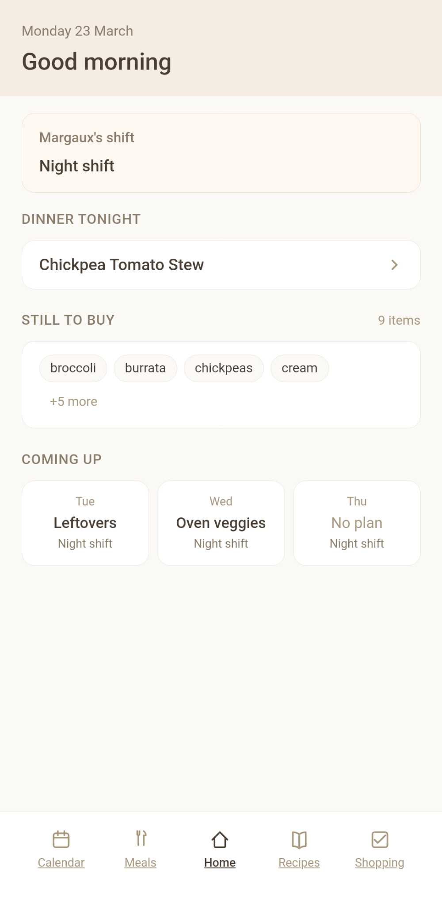
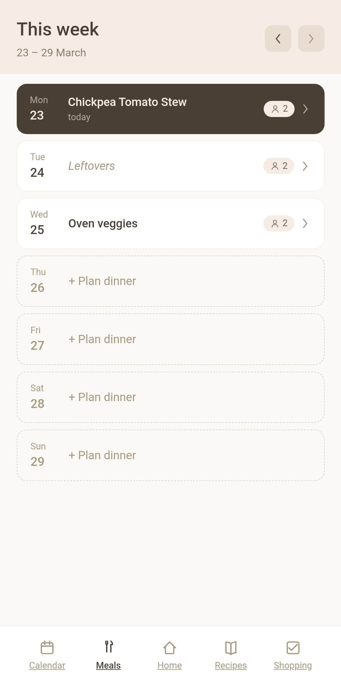

# OurHome

A household PWA for two people:

- **Meals and recipes**: a weekly meal plan drawing on a shared recipe book
- **Shopping**: a shared list, sorted by store section, that can fill a Picnic cart
- **Calendar**: shifts, appointments and work events synced from ICS feeds
- **Tasks**: a board that shows only what needs doing
- **Rooms**: temperature and humidity from Bluetooth sensors, with history
- **Heating**: radiator valve targets through a Shelly BLU gateway
- **Vacuum**: a weekly Roborock cleaning schedule

<p align="center">
  
  
</p>

## Stack

- **Backend**: FastAPI and SQLite
- **Frontend**: React, Vite and TypeScript

## Deployment

Every push to `main` builds backend and frontend images for `linux/amd64` and `linux/arm64` and pushes them to `ghcr.io/maxthfe/household-app`. On the server:

```bash
cp backend/.env.example backend/.env   # fill in what you use; every integration is optional
docker compose pull
docker compose up -d
```

The frontend listens on port 8080 (set `FRONTEND_PORT` in a `.env` next to `docker-compose.yml` to change it). Data lives in `backend/data`. `deploy.sh` pulls new images and restarts only when they changed, so it can run from cron.

Picnic and Roborock need a one-time login per account, which saves a token in `backend/data`:

```bash
docker compose exec backend python picnic_setup.py <user-name>
docker compose exec backend python roborock_setup.py
```

## Local development

```bash
cd backend && uv sync && uv run uvicorn app.main:app --reload   # http://localhost:8000
cd frontend && npm install && npm run dev                       # http://localhost:5173
```

## License

[MIT](LICENSE)
