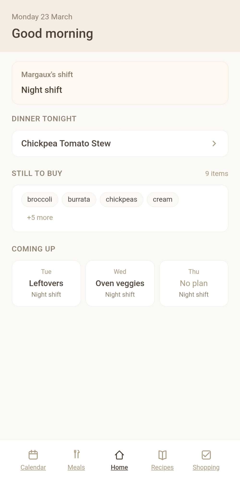
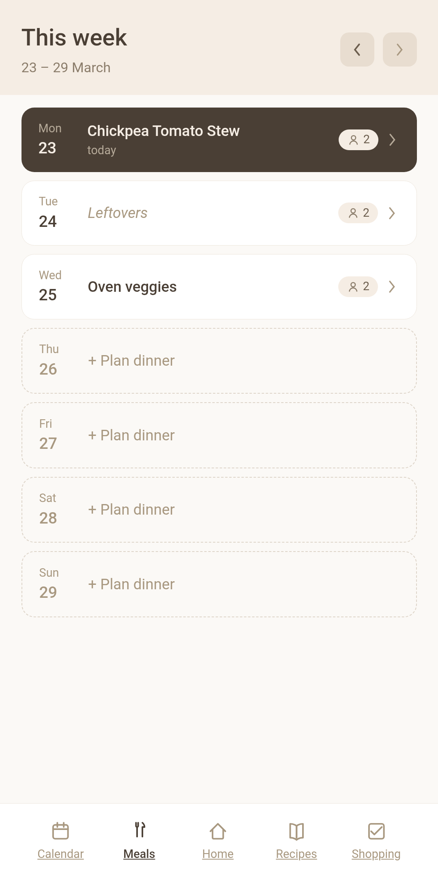

# OurHome

A household management PWA built for two people. It covers meal planning with a shared recipe book, a collaborative shopping list, a calendar that syncs work shifts and general appointments from ICS feeds, and live room temperature and humidity.

<p align="center">
  
  
</p>

## Stack

- **Backend** — FastAPI + SQLite (aiosqlite), runs on a Raspberry Pi
- **Frontend** — React + Vite + TypeScript PWA

---

## Raspberry Pi deployment

The backend is published as a Docker image (ARM64) via GitHub Actions on every push to `main`.

### Pull and run

```bash
docker pull ghcr.io/maxthfe/household-app/backend:latest

docker run -d \
  --name ourhome \
  --restart unless-stopped \
  -p 8000:8000 \
  -v /home/pi/ourhome/data:/app/data \
  -e HT_USER1_NAME=UserName1 \
  -e HT_USER2_NAME=UserName2 \
  -e HT_ICS_URL=<your-shift-ics-url> \
  -e HT_ICS_GENERAL_URL=<your-general-ics-url> \
  -e HT_ICS_WORK_URL=<your-work-ics-url> \
  -e HT_ICS_SYNC_INTERVAL_MINUTES=30 \
  ghcr.io/maxthfe/household-app/backend:latest
```

The SQLite database is persisted at `/home/pi/ourhome/data` on the host.

### Picnic ordering

"Order via Picnic" on the shopping list fills the Picnic cart of whoever presses it (it never checks out). OpenAI matches each item to a Picnic product once; the match is cached, and anything unclear becomes a question in the app. Put these in `backend/.env` (leave a user's Picnic lines empty if they have no account):

```bash
HT_PICNIC_USER1_EMAIL=<picnic-email>
HT_PICNIC_USER1_PASSWORD=<picnic-password>
HT_PICNIC_USER2_EMAIL=
HT_PICNIC_USER2_PASSWORD=
HT_OPENAI_API_KEY=<openai-key>
```

Then log in once per user — Picnic sends an SMS code — which saves `data/picnic_token_<user>.json`:

```bash
docker compose exec backend python picnic_setup.py <user-name>
```

### Update to latest

```bash
docker pull ghcr.io/maxthfe/household-app/backend:latest
docker restart ourhome
```
---

## Local development

### Backend

```bash
cd backend
uv sync
uv run uvicorn app.main:app --reload
```

Runs at `http://localhost:8000`. Copy `.env.example` to `.env` and fill in your values.

### Frontend

```bash
cd frontend
npm install
npm run dev
```

Runs at `http://localhost:5173`.

---

## GitHub Actions

On push to `main` (backend files only), a Docker image is built for `linux/arm64` and pushed to the GitHub Container Registry (`ghcr.io`).

---

## License

[MIT](LICENSE)
